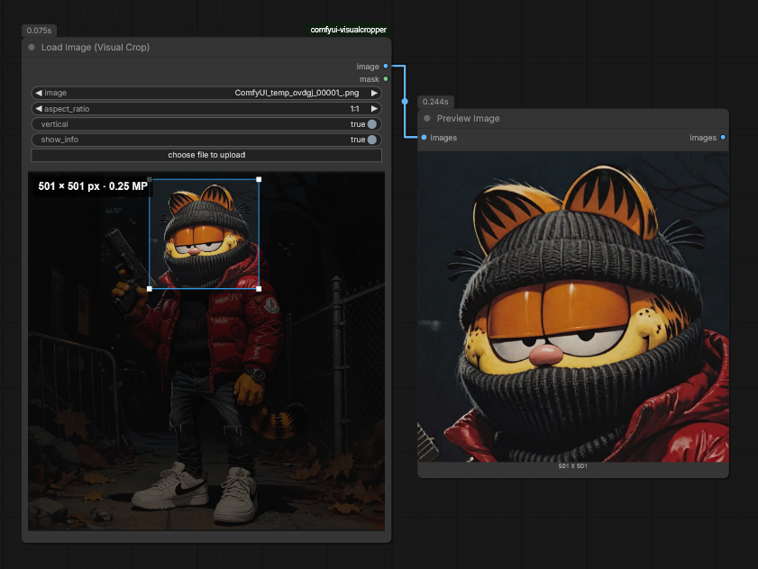

# ComfyUI Visual Cropper

Select a crop visually and send the result straight into your ComfyUI workflow.

## Install

Place this repository in `ComfyUI/custom_nodes/comfyui-visualcropper`, then restart ComfyUI.

## Use

- Choose or upload an image, then select an aspect ratio or **Free**.
- Drag to create a crop; drag inside it to move, or use a handle to resize.
- Use **vertical** to flip a preset's orientation. Toggle **show_info** to display crop dimensions and megapixels.
- Connect **IMAGE** to **Preview Image**. The node also outputs a transparency **MASK**.

Resize the node freely—the preview fits while preserving the source image's proportions.
